

<!-- Animated Typing Slogan -->

<!-- Hero Cyber Grid, Hologram Radar, Dual Laser Sweeps & Live Product Chips -->

<!-- Unified Single-Row Cyber Dock Buttons -->
<table>
  <tr>
    <td width="20%"></td>
    <td width="20%"><a href="https://data.domation.net/ecolife"></a></td>
    <td width="20%"></td>
    <td width="20%"></td>
    <td width="20%"></td>
  </tr>
</table>

<!-- Animated Border-Laser KPI Matrix -->

 

<!-- Section 01: Production Software Mesh -->

 

<!-- Section 02: Real Production Apps Showcase (All 8 Interactive Cyber Cards with Embedded Live Screenshots) -->

<table>
  <tr>
    <td width="50%"><a href="https://data.domation.net/ecolife"></a></td>
    <td width="50%"><a href="https://domation.net/erp"></a></td>
  </tr>
  <tr>
    <td width="50%"><a href="https://crm-domation.vercel.app/"></a></td>
    <td width="50%"><a href="https://domation.net/automation"></a></td>
  </tr>
  <tr>
    <td width="50%"><a href="https://ai.ecolifesignature.vn/"></a></td>
    <td width="50%"><a href="https://ai.inkica.com/"></a></td>
  </tr>
  <tr>
    <td width="50%"><a href="https://nhakhoaflora.com"></a></td>
    <td width="50%"><a href="https://domation.net"></a></td>
  </tr>
</table>

<b>📂 Mở danh sách đầy đủ 15+ Apps &amp; 69+ GitHub Repositories (PORTFO · EDU-APP · MYERP · Tools · OSS)</b>

 

| App / Repository | Category | Architecture &amp; Live Link |
|:---|:---|:---|
| **[DOMATION_TENANRT](https://github.com/DEV-trongphuc/DOMATION_TENANRT)** | Multi-Tenant Backend Kernel | `TypeScript` · `Express` · `PostgreSQL / PGlite FORCE RLS` (`182+` tables), RBAC, VietQR, OCR |
| **[domation_page](https://github.com/DEV-trongphuc/domation_page)** | Main SaaS Portal &amp; `/data` | `React 19` · `TypeScript` · `Vite SSR Prerender` (`89` HTML targets) · Blog RAG · [domation.net](https://domation.net) |
| **[MYERP](https://github.com/DEV-trongphuc/MYERP)** · **[IDEAS_ERP](https://github.com/DEV-trongphuc/IDEAS_ERP)** | Enterprise ERP 5.0 Suite | 12-module ERP (HRM, GPS Selfie AI Attendance, Payroll PDF, Approvals, Accounting, WorkChat) |
| **[AUTOFLOW](https://github.com/DEV-trongphuc/AUTOFLOW)** · **[crm](https://github.com/DEV-trongphuc/crm)** | CRM 360° &amp; Flow Studio | Visual `IF/ELSE` Flow Builder, Email SES Builder, Survey, QR Voucher Hub |
| **[portfo](https://github.com/DEV-trongphuc/portfo)** | Executive Portfolio App | Interactive 3D Showcase &amp; AI RAG Assistant — [portfo-turnio.vercel.app](https://portfo-turnio.vercel.app/) |
| **[flora](https://github.com/DEV-trongphuc/flora)** | HealthTech Fintech App | Affiliate KOL Portal (Secret Token) &amp; ACB VietQR Webhook — [nhakhoaflora.com](https://nhakhoaflora.com) |
| **[Green-Living-Lab](https://github.com/DEV-trongphuc/Green-Living-Lab)** | PropTech WebGL 3D | EcoLife Signature Three.js Draco 3D Showcase — [ai.ecolifesignature.vn](https://ai.ecolifesignature.vn/) |
| **[EDU-APP](https://github.com/DEV-trongphuc/EDU-APP)** · **Brandson** · **ImplantSwiss** | EdTech &amp; Medical Apps | Academic Gradebook, Timetable, CME Portal &amp; Regional RLS CRM ([brandson.vn](https://brandson.vn), [implantswiss.vn](https://implantswiss.vn/)) |
| **[NAVATEK](https://github.com/DEV-trongphuc/NAVATEK)** · **[minth](https://github.com/DEV-trongphuc/minth)** · **[Tarot-Vibecode](https://github.com/DEV-trongphuc/Tarot-Vibecode)** | Commerce &amp; Interactive Web | High-speed Brand Storefronts, Rich Land DataBank ([rich-land.vercel.app](https://rich-land.vercel.app/)) &amp; Interactive Web Apps |
| **[dom_tools](https://github.com/DEV-trongphuc/dom_tools)** · **[divideo](https://github.com/DEV-trongphuc/divideo)** · **[vnstock](https://github.com/DEV-trongphuc/vnstock)** | Internal Dev Utilities | Media processing UI, transcript extraction &amp; market data tooling |
| **[slider](https://github.com/DEV-trongphuc/slider)** (⭐10) · **[sliderInfinity](https://github.com/DEV-trongphuc/sliderInfinity)** (⭐7) · **[library](https://github.com/DEV-trongphuc/library)** (⭐6) | Open-Source UI Libraries | Lightweight frontend sliders, layout kits &amp; utilities (`29+` combined stars) |

 

<!-- Section 03: Tech Orbit Solar System -->

 

  

<!-- Section 04: Live GitHub Telemetry -->

 

&nbsp;

 

 

 

<!-- Section 05: Animated 2026 Product Roadmap -->

 

<!-- Section 06: 30+ Enterprise Partners in Cyber Canvas -->

<b>🏅 Verified Engineering Certifications (freeCodeCamp · Fullstack F8 · TOP CV)</b>

 

| Certificate | Issuer | Year | Link |
|:---|:---:|:---:|:---:|
| Front End Development Libraries | freeCodeCamp | 2021 | [Verify](https://www.freecodecamp.org/certification/trongphuc3105/front-end-development-libraries) |
| Responsive Web Design | freeCodeCamp | 2021 | [Verify](https://www.freecodecamp.org/certification/trongphuc3105/responsive-web-design) |
| JavaScript Advanced | Fullstack F8 | 2022 | [Verify](https://f8.edu.vn/certificates/t7s3s) |
| ReactJS | Fullstack F8 | 2022 | [Verify](https://f8.edu.vn/certificates/7jzkn) |
| HTML / CSS | Fullstack F8 | 2021 | [Verify](https://f8.edu.vn/certificates/t7s3s) |
| JavaScript — Top 20% | TOP CV | 2023 | [Verify](https://certificate.testcenter.vn/dUR8Uz0fMlcZNV9GVjE2bFN7SXU) |

 

<!-- Unified Cyber Footer Canvas -->

 

