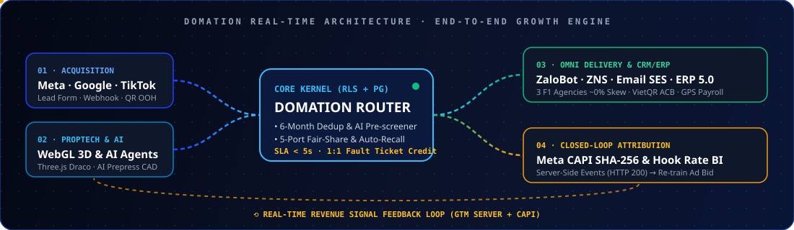

<div align="center">

<!-- Animated Gradient Wave Banner -->


<br/>

<!-- Animated Typing Tagline -->
<a href="https://domation.net">
  
</a>

<br/><br/>

<!-- Custom Animated Cyber HUD Card (SMIL Animated) -->


<br/><br/>

<!-- Quick Navigation & Social Badges -->
[](https://domation.net)
[](https://domation.net/portfolio)
[](https://domation.net/data)
[](https://data.domation.net/ecolife)
[](https://meta.domation.net)
[](https://domation.net/boost)

<br/>

[](https://portfo-turnio.vercel.app/)
[](https://www.tiktok.com/@turnio.dev)
[](https://www.linkedin.com/in/turnio-dev/)
[](https://www.facebook.com/3105trongphuc)
[](https://zalo.me/0378859736)
[](mailto:domation.net@gmail.com)


<br/>

<!-- Custom Animated KPI Telemetry Strip -->


</div>

<br/>

---

<div align="center">

## ⚡ `ABOUT ME // THE HYBRID ARCHITECT`

</div>

```typescript
/**
 * ╔══════════════════════════════════════════════════════════════════════════╗
 * ║         HUYNH TRONG PHUC (TURNIO) — Marketing × Automation × Code        ║
 * ║         Building Enterprise Growth OS & Bespoke AI Platforms 🇻🇳          ║
 * ╚══════════════════════════════════════════════════════════════════════════╝
 */
const architectProfile = {
  fullName   : "Huynh Trong Phuc",
  alias      : "TURNIO · @DEV-trongphuc",
  title      : "Founder & Chief Solutions Architect @ DOMATION.NET",
  location   : "Ho Chi Minh City, Vietnam 🇻🇳",
  education  : "Banking University HCMC (Business Admin & Marketing · 2019–2023)",

  pillars: {
    autoDataRouter : "Multi-Tenant SaaS · 5-Port Round-Robin · ZaloBot < 5s · 1:1 Fault Ticket",
    enterpriseOS   : "CRM 360° Kanban · ERP 5.0 (GPS AI Selfie Check-In, Payroll PDF, Approvals)",
    omnichannelAI  : "Visual IF/ELSE Flows · Amazon SES 98% Inbox · Zalo OA/ZNS · RAG AI Agents",
    proptechAnd3D  : "Three.js Draco WebGL (3D Cutaway Floorplans) · Multi-Agent AI CAD Prepress",
    performanceAds : "Meta Ads API · TikTok · Google Ads · GTM Server-Side · Meta CAPI SHA-256",
  },

  productionProof: {
    partnersServed : "30+ Enterprise Brands across Real Estate, EdTech, F&B, Dental & POD",
    flagshipCases  : "10 Deep End-to-End Case Studies (Capital House, INKICA, IDEAS, Flora, PLT...)",
    monthlyAdSpend : "500,000,000+ VND/mo managed · 4.8x – 5x Avg ROAS",
    leadsProcessed : "150,000+ leads routed with 6-month multi-channel deduplication",
    leadDelivery   : "< 5 seconds from Ad Form / Web 3D -> ZaloBot / CRM -> Meta CAPI 200",
  },

  philosophy: "Chạm đúng người · Đúng thời điểm · Tự động hóa khép kín từ Ads đến Doanh thu ⚡",
};
```

<br/>

---

<div align="center">

## ⚡ `DOMATION LIVE ARCHITECTURE (ANIMATED PIPELINE)`

<br/>



<br/><br/>

### 🌐 `DOMATION ECOSYSTEM 6 CORE PLATFORMS`

| # | Platform | Route / Live App | Core Capabilities |
|:---:|:---|:---|:---|
| `01` | **Auto Data & F1 Router** | [domation.net/data](https://domation.net/data) · [Live EcoLife](https://data.domation.net/ecolife) | Fair-Share 5-Port Round-Robin, ZaloBot & Telegram `< 5s`, 6-month dedup, SLA auto-recall, 1:1 Fault Compensation & Meta CAPI HTTP 200 |
| `02` | **DOMATION CRM 360°** | [domation.net/crm](https://domation.net/crm) · [Demo CRM](https://crm-domation.vercel.app/) | 8-Stage Kanban Pipeline, Lead Temperature Scoring, Live Inventory Cart, Commission Split & E-Invoice Webhook |
| `03` | **Enterprise ERP 5.0** | [domation.net/erp](https://domation.net/erp) | 12 Bespoke Modules: Task Kanban, Office GPS + Selfie AI Attendance, Multi-step Approval Inbox, Payroll Engine & PDF Payslip |
| `04` | **Marketing Flow & AI** | [domation.net/automation](https://domation.net/automation) | Visual IF/ELSE Condition Flow, Email Drag & Drop Amazon SES (98% Inbox), Zalo ZNS, Voucher Hub & RAG PDF AI Chatbot 24/7 |
| `05` | **Meta Ads BI & Hook Rate** | [meta.domation.net](https://meta.domation.net) · [Specs](https://domation.net/meta-report) | Real-time Graph API reconciliation vs CRM Qualified/Revenue, Video 3s Hook Rate, Hold Rate & Golden Hour Close Analytics |
| `06` | **Web 3D & SEO/GEO Hub** | [domation.net/web-design](https://domation.net/web-design) · [Blog](https://domation.net/boost) | Sub-3s Brand Sites, Three.js Draco WebGL 3D Floorplans, Full Prerender, Dynamic JSON-LD & `llms.txt` AI Search Standard |

</div>

<br/>

---

<div align="center">

## 🏆 `FLAGSHIP PORTFOLIO & LIVE PRODUCTION SYSTEMS`

> *Toàn bộ 10 dự án Flagship thực tế đang vận hành — từ BĐS 3D WebGL, AI CAD Prepress đến ERP 5.0, Affiliate VietQR & Chuỗi F&B.*

</div>

<br/>

<table>
  <tr>
    <td width="50%" valign="top">
      <a href="https://ai.ecolifesignature.vn/">
        
      </a>
      <br/>
      <h4>🏙️ EcoLife Signature Đà Nẵng · Web 3D &amp; Auto F1 Router</h4>
      <sub><b>Capital House Group</b> · IFC EDGE Green Real Estate (2026)</sub>
      <br/><br/>
      <code>Three.js Draco 3D</code> <code>AI Sales 24/7</code> <code>ZaloBot &lt;5s</code> <code>Meta CAPI</code>
      <ul>
        <li><b>8 Căn hộ 3D bóc mái</b> nén Draco (<code>&lt; 3.5MB</code>), mượt trên Mobile Safari</li>
        <li><b>Auto Data Router 3 Đại lý F1</b> (Tùng Long, Hợp Nhất, IHD) độ lệch ~0%</li>
        <li><b>25 ấn phẩm OOH</b> gắn QR Tracking + 1:1 Ticket Compensation</li>
      </ul>
      <a href="https://ai.ecolifesignature.vn/"></a>
      <a href="https://data.domation.net/ecolife"></a>
    </td>
    <td width="50%" valign="top">
      <a href="https://ai.inkica.com/">
        
      </a>
      <br/>
      <h4>🤖 INKICA AI POD Studio · Multi-Agent 3D CAD Prepress</h4>
      <sub><b>INKICA Global Studio</b> · Print-on-Demand &amp; AI 3D Garment (2026)</sub>
      <br/><br/>
      <code>Next.js 14</code> <code>Three.js</code> <code>BullMQ GPU</code> <code>SAM 3 + ViTMatte</code>
      <ul>
        <li><b>Omni Orchestrator 6 AI Agents</b> xử lý Listing → Fulfillment trong <b>60s</b></li>
        <li><b>Neural Extract 300 DPI</b> tách nền &amp; chuẩn hóa lưới UV Cubic Bezier</li>
        <li><b>AOP 3D CAD 208 SKU</b> &amp; 88 Canonical Models với <b>0 px</b> lệch đường may</li>
      </ul>
      <a href="https://ai.inkica.com/"></a>
      <a href="https://domation.net/portfolio"></a>
    </td>
  </tr>
  <tr>
    <td width="50%" valign="top">
      <a href="https://data.domation.net/ecolife">
        
      </a>
      <br/>
      <h4>⚡ DOMATION Enterprise OS &amp; Auto Data V2 Engine</h4>
      <sub><b>DOMATION SaaS</b> · Multi-Tenant PostgreSQL + RLS Kernel (2026)</sub>
      <br/><br/>
      <code>TypeScript</code> <code>Express</code> <code>Postgres FORCE RLS</code> <code>CAPI SHA-256</code>
      <ul>
        <li>Phân quyền <b>Kernel FORCE RLS</b> + cô lập 4 tầng RBAC đa chi nhánh</li>
        <li>Chia vòng trọng số, thu hồi SLA quá hạn &amp; bù lead lỗi tự động 1-đổi-1</li>
        <li>Auto hash SHA-256 bắn sự kiện <b>Qualified / Notlead → Meta CAPI 200</b></li>
      </ul>
      <a href="https://domation.net/data"></a>
      <a href="https://github.com/DEV-trongphuc/DOMATION_TENANRT"></a>
    </td>
    <td width="50%" valign="top">
      <a href="https://nhakhoaflora.com">
        
      </a>
      <br/>
      <h4>💎 Nha Khoa Flora · Affiliate KOL, VietQR ACB &amp; HIPAA Mask</h4>
      <sub><b>Hệ Thống Nha Khoa Flora</b> · HealthTech &amp; Fintech Webhook (2026)</sub>
      <br/><br/>
      <code>VietQR ACB API</code> <code>Webhook Reconciliation</code> <code>Zalo OA</code> <code>HIPAA Mask</code>
      <ul>
        <li>Checkout E-Voucher sinh mã <b>VietQR ACB</b> tự gắn mã KOL/SĐT/Đơn</li>
        <li><b>ACB Webhook</b> đối soát gạch nợ &amp; tính hoa hồng chỉ trên đơn Paid</li>
        <li>Cổng Partner Portal không cần đăng nhập qua Secret Token + ẩn SĐT y khoa</li>
      </ul>
      <a href="https://nhakhoaflora.com"></a>
      <a href="https://github.com/DEV-trongphuc/flora"></a>
    </td>
  </tr>
  <tr>
    <td width="50%" valign="top">
      <a href="https://ideas.edu.vn/mba">
        
      </a>
      <br/>
      <h4>🎓 IDEAS Business · ERP 5.0 12 Phân Hệ &amp; Phễu MBA</h4>
      <sub><b>Viện Quản Trị IDEAS</b> · EdTech &amp; Bespoke ERP (2025–2026)</sub>
      <br/><br/>
      <code>ERP 5.0 12 Modules</code> <code>GPS AI Selfie</code> <code>Payroll PDF</code> <code>Zalo Mini App</code>
      <ul>
        <li>Thay thế 14 file Excel: Task Kanban, Chấm công GPS AI, Duyệt đơn &amp; Lương PDF</li>
        <li>Scale tuyển sinh MBA Quốc tế: <b>+300% quy mô (20 → 60 HV/khóa)</b></li>
        <li>Tối ưu Lead Form + CRM 8 nấc: <b>-30% CPA</b> trên <b>12,600+ Leads</b></li>
      </ul>
      <a href="https://ideas.edu.vn/mba"></a>
      <a href="https://github.com/DEV-trongphuc/IDEAS_ERP"></a>
    </td>
    <td width="50%" valign="top">
      <a href="https://meta.domation.net">
        
      </a>
      <br/>
      <h4>📡 Meta Ads Realtime BI &amp; Marketing Flow Studio</h4>
      <sub><b>Phúc Lộc Thọ · Rich Land · Ampersand</b> · Performance BI (2025–2026)</sub>
      <br/><br/>
      <code>Meta Graph API</code> <code>IF/ELSE Flow</code> <code>Amazon SES</code> <code>Zalo ZNS</code>
      <ul>
        <li><b>Phúc Lộc Thọ</b>: Kết nối POS 30+ cửa hàng → ZNS &amp; Voucher Hub, <b>ROAS 5+</b></li>
        <li><b>Rich Land</b>: CRM Tranh nhận / Chia vòng + DataBank &amp; Ads Pipeline Tracker</li>
        <li><b>Meta Report Portal</b>: Video 3s Hook Rate, Hold Rate &amp; CPL Thực vs Doanh thu</li>
      </ul>
      <a href="https://meta.domation.net"></a>
      <a href="https://domation.net/automation"></a>
    </td>
  </tr>
</table>

<details>
<summary><b>📂 Xem toàn bộ 10 Flagship Case Studies &amp; Kiến trúc chi tiết (ImplantSwiss, Rich Land, Nava Store, Brandson, DOMATION Portal...)</b></summary>
<br/>

| Project / Client | Industry & Year | Live URL / Demo | Highlight Architecture & Verified Proof |
|:---|:---|:---|:---|
| **EcoLife Signature Đà Nẵng** *(Capital House)* | PropTech Web 3D · 2026 | [ai.ecolifesignature.vn](https://ai.ecolifesignature.vn/) · [Workspace](https://data.domation.net/ecolife) | Sa bàn Three.js Draco 8 căn 3D (`<3.5MB`), AI Sale 24/7, Auto Chia F1 3 sàn `<5s`, 25 ấn phẩm OOH QR Tracking |
| **INKICA AI POD Studio** | AI Prepress 3D · 2026 | [ai.inkica.com](https://ai.inkica.com/) | Next.js 14 + Three.js + BullMQ GPU Pool, 6 AI Agents, SAM 3 + ViTMatte 300 DPI, 208 SKU AOP 3D (`0 px` seam offset) |
| **IDEAS Business** *(Viện Quản Trị IDEAS)* | EdTech & ERP 5.0 · 2025–2026 | [ideas.edu.vn/mba](https://ideas.edu.vn/mba) | ERP 5.0 12 phân hệ, GPS Selfie AI, Payroll PDF, CRM 8 nấc — `+300%` quy mô (`20→60 HV`), `-30% CPA`, `12,600+` Leads |
| **Phúc Lộc Thọ** *(Cơm Tấm Phúc Lộc Thọ)* | F&B Franchise 30+ Stores · 2025–2026 | [phucloctho.vn](https://phucloctho.vn) | POS Middleware → Zalo ZNS hậu mãi 2h, Voucher Hub mã động 1 lần, Phễu Nhượng quyền `1,600+` hồ sơ, `20+` cửa hàng mới, `ROAS 5+` |
| **Nha Khoa Flora** | HealthTech & Affiliate · 2026 | [nhakhoaflora.com](https://nhakhoaflora.com) | Checkout VietQR ACB Webhook đối soát 100%, Secret Token Partner Portal, che SĐT chuẩn HIPAA, Zalo OA & Napas 24/7 |
| **Rich Land** | PropTech CRM & DataBank · 2026 | [rich-land.vercel.app](https://rich-land.vercel.app/) | Dual-mode CRM (Tranh nhận Pool Claim / Chia vòng), kho DataBank tập trung, lọc trùng đa kênh & SLA auto-recall |
| **ImplantSwiss Việt Nam** | Medical Device B2B · 2025–2026 | [implantswiss.vn](https://implantswiss.vn/) | Row-Level Security cô lập dữ liệu vùng miền, Phone Masking Audit Logs & Meta CAPI SHA-256 |
| **Nava Store** | E-Commerce & Tracking · 2025 | [navastore.vn](https://navastore.vn/) | Custom UI/UX `< 3s` load, SEO On-Page 100%, Pixel + CAPI Sync & đồng bộ SKU kế toán |
| **Brandson Academy** | Medical CME Funnel · 2025 | [brandson.vn](https://brandson.vn) | Storytelling Landing Page y khoa, Amazon SES `98% Inbox` Syllabus auto-delivery & `< 5s` CRM Webhook |
| **DOMATION Knowledge & Portfolio Hub** | Martech · SEO & GEO · 2026 | [domation.net/boost](https://domation.net/boost) · [portfo](https://portfo-turnio.vercel.app/) | 50+ bài phân tích chuyên sâu, 89 HTML Prerender targets, Dynamic JSON-LD Schema, RAG Hybrid Search & `llms.txt` GEO |

</details>

<br/>

---

<div align="center">

## 🗂️ `FEATURED GITHUB REPOSITORIES (69 PUBLIC REPOS)`

</div>

<table>
  <tr>
    <th>Category</th>
    <th>Repository</th>
    <th>Stack &amp; Focus</th>
  </tr>
  <tr>
    <td><b>🏢 Multi-Tenant Backend</b></td>
    <td><a href="https://github.com/DEV-trongphuc/DOMATION_TENANRT"><b>DEV-trongphuc/DOMATION_TENANRT</b></a></td>
    <td><code>TypeScript</code> · Multi-Tenant SaaS Kernel, PostgreSQL/PGlite FORCE RLS, Fair-Share Lead Router, Meta CAPI v21.0, ZaloBot, Payroll &amp; Approvals</td>
  </tr>
  <tr>
    <td><b>🌐 Main SaaS &amp; Portal</b></td>
    <td><a href="https://github.com/DEV-trongphuc/domation_page"><b>DEV-trongphuc/domation_page</b></a></td>
    <td><code>TypeScript</code> · <code>React 19</code> · DOMATION.NET Enterprise Portal, <code>/data</code> Workspace, 3D Inspection Hub &amp; SEO/GEO Blog (<code>/boost</code>)</td>
  </tr>
  <tr>
    <td><b>⚙️ Enterprise ERP</b></td>
    <td><a href="https://github.com/DEV-trongphuc/MYERP"><b>MYERP</b></a> · <a href="https://github.com/DEV-trongphuc/IDEAS_ERP"><b>IDEAS_ERP</b></a> · <a href="https://github.com/DEV-trongphuc/crm"><b>crm</b></a></td>
    <td><code>TypeScript</code> · Full ERP 5.0 (HRM, GPS Check-In, Payroll, Finance, PO/SO, WorkChat, B2B Deals &amp; AI Assistants)</td>
  </tr>
  <tr>
    <td><b>📡 Ads &amp; Marketing Apps</b></td>
    <td><a href="https://github.com/DEV-trongphuc/AUTOFLOW"><b>AUTOFLOW</b></a> · <a href="https://github.com/DEV-trongphuc/DOM-META-AMPER"><b>DOM-META-AMPER</b></a> · <a href="https://github.com/DEV-trongphuc/DOM-MARKETING"><b>DOM-MARKETING</b></a></td>
    <td><code>TypeScript</code> · <code>JavaScript</code> · Real-time Meta Graph API Reports, Visual Condition Flows &amp; Automated Campaign Hubs</td>
  </tr>
  <tr>
    <td><b>💎 Vertical Systems</b></td>
    <td><a href="https://github.com/DEV-trongphuc/flora"><b>flora</b></a> · <a href="https://github.com/DEV-trongphuc/Green-Living-Lab"><b>Green-Living-Lab</b></a> · <a href="https://github.com/DEV-trongphuc/EDU-APP"><b>EDU-APP</b></a> · <a href="https://github.com/DEV-trongphuc/portfo"><b>portfo</b></a></td>
    <td><code>TypeScript</code> · <code>HTML</code> · Affiliate VietQR ACB System, EcoLife PropTech &amp; Executive Interactive Portfolio</td>
  </tr>
  <tr>
    <td><b>⭐ UI &amp; OSS Utilities</b></td>
    <td><a href="https://github.com/DEV-trongphuc/slider"><b>slider</b></a> (⭐10) · <a href="https://github.com/DEV-trongphuc/sliderInfinity"><b>sliderInfinity</b></a> (⭐7) · <a href="https://github.com/DEV-trongphuc/Download_ME"><b>Download_ME</b></a> (⭐6) · <a href="https://github.com/DEV-trongphuc/library"><b>library</b></a> (⭐6)</td>
    <td><code>CSS</code> · <code>HTML</code> · <code>JS</code> · High-FPS Web Sliders, Frontend Component Libraries &amp; Developer Utilities</td>
  </tr>
</table>

<br/>

---

<div align="center">

## 🛠️ `TECH STACK & GROWTH ARSENAL`

<br/>


<br/><br/>


</div>

<br/>

---

<div align="center">

## 📊 `LIVE GITHUB TELEMETRY (@DEV-trongphuc)`

<br/>


<br/><br/>


&nbsp;


<br/><br/>


<br/><br/>


</div>

<br/>

---

<div align="center">

## 🤝 `30+ ENTERPRISE BRAND PARTNERS`

</div>

<table>
  <tr>
    <th>🏗️ Real Estate &amp; AI Tech</th>
    <th>🎓 International Education</th>
    <th>🍽️ F&amp;B Chains &amp; Franchise</th>
    <th>🏥 Dental, Retail &amp; Service</th>
  </tr>
  <tr>
    <td>
      • <b>Capital House Group</b><br/>
      • <b>EcoLife Signature Đà Nẵng</b><br/>
      • <b>INKICA AI POD Studio</b><br/>
      • <b>Rich Land PropTech</b><br/>
      • Địa Ốc Tùng Long · Hợp Nhất Land · Tập Đoàn IHD
    </td>
    <td>
      • <b>IDEAS Business Institute</b><br/>
      • <b>Swiss UMEF</b><br/>
      • <b>Collège de Paris</b><br/>
      • <b>ESTIAM Paris</b><br/>
      • <b>ISTEC Paris</b><br/>
      • Ascencia Business School · VTCI Edu
    </td>
    <td>
      • <b>Phúc Lộc Thọ</b> (30+ stores)<br/>
      • <b>Ampersand Group</b><br/>
      • <b>Häagen-Dazs</b> · <b>The Running Bean</b><br/>
      • <b>Esta Saigon</b> · <b>Snowee</b> · <b>Le Petit</b><br/>
      • En Group · Abiru-EN · KA-EN · Kiwami Ramen · Cowboy Steak · Bếp Nhà SON · Cơm Gà Đệ Nhất
    </td>
    <td>
      • <b>Nha Khoa Flora</b><br/>
      • <b>ImplantSwiss Việt Nam</b><br/>
      • <b>Brandson Academy</b><br/>
      • Navastore · Navatek<br/>
      • MINTH Store · Duyên Mai · Mystery Tarot · An Ninh Tiên Hoàng
    </td>
  </tr>
</table>

<br/>

---

<div align="center">

## 💼 `CAREER JOURNEY & CERTIFICATIONS`

</div>

| Period | Role | Organization | Core Impact |
|:---:|:---|:---|:---|
| `2024 → NOW` | 🏢 **Founder & Chief Architect** | **DOMATION Enterprise** (`domation.net`) | Built Auto Data V2 Router, CRM 360°, ERP 5.0 12 modules, Meta BI Portal & 30+ partner systems |
| `2023 – 2024` | 💻 **Digital Marketing & Fullstack Dev** | **IDEAS Institute** | Scaled MBA cohorts 3× (`20 → 60 HV`), `-30%` CPA, replaced 14 Excel sheets with bespoke ERP 5.0 |
| `2022 – 2023` | 📣 **Digital Marketing Specialist** | **Le Gia ICT** | Managed multi-channel performance ads & high-converting SEO infrastructure |
| `2019 – 2023` | 🎓 **B.A. Business Admin – Marketing** | **Banking University HCMC** | Combined performance marketing analytics with fullstack software engineering |

<details>
<summary><b>📜 Verified Technical & Marketing Certifications (freeCodeCamp · Fullstack F8 · TOP CV)</b></summary>
<br/>

| 🏅 Certificate | 🎓 Issuer | 📅 Year | 🔗 Verify |
|:---|:---:|:---:|:---:|
| Front End Development Libraries | freeCodeCamp | 2021 | [Verify](https://www.freecodecamp.org/certification/trongphuc3105/front-end-development-libraries) |
| Responsive Web Design | freeCodeCamp | 2021 | [Verify](https://www.freecodecamp.org/certification/trongphuc3105/responsive-web-design) |
| JavaScript Advanced | Fullstack F8 | 2022 | [Verify](https://f8.edu.vn/certificates/t7s3s) |
| ReactJS | Fullstack F8 | 2022 | [Verify](https://f8.edu.vn/certificates/7jzkn) |
| HTML / CSS | Fullstack F8 | 2021 | [Verify](https://f8.edu.vn/certificates/t7s3s) |
| JavaScript — Top 20% | TOP CV | 2023 | [Verify](https://certificate.testcenter.vn/dUR8Uz0fMlcZNV9GVjE2bFN7SXU) |
| SEO Specialist | TOP CV | 2023 | [Verify](https://certificate.testcenter.vn/dUR8UT0fMlcZNV9GVjE2bFN7SXU) |

</details>

<br/>

---

<div align="center">

## 🚀 `2026 ROADMAP & DIRECT CONNECT`

```text
  ✅  Multi-Tenant Auto Data Kernel (FORCE RLS + Fair-Share 5-Port + ZaloBot < 5s)
  ✅  EcoLife Signature Web 3D Draco + 3 F1 Agency Distribution + 25 OOH QR Tracking
  ✅  INKICA Multi-Agent 3D CAD Prepress (6 AI Agents · 208 SKU · SAM 3 + ViTMatte)
  ✅  Nha Khoa Flora VietQR ACB Webhook + HIPAA Phone Masking Partner Portal
  ✅  DOMATION /boost SEO & GEO Hub (50+ Case Articles · Dynamic JSON-LD · llms.txt)
  🚧  DOM Agent Multi-Department Co-Pilot & Automated ERP Execution Engine
  🚧  White-label Meta Ads Creative Hook-Rate Telemetry for Enterprise Agencies
  📌  Scaling Zalo Mini App + POS Ecosystem across 50+ F&B / Franchise Locations
```

<br/>

[](https://domation.net)
[](https://domation.net/portfolio)
[](https://zalo.me/0378859736)
[](mailto:domation.net@gmail.com)
[](https://www.facebook.com/domation.net/)

<br/>

> *"Hợp nhất Performance Marketing, Fullstack Engineering và AI Automation — biến từng click quảng cáo thành doanh thu có thể đo lường và tự động hóa 100%."*  
> — **Huỳnh Trọng Phúc (`TURNIO`) · DOMATION Enterprise**

<br/>


</div>
