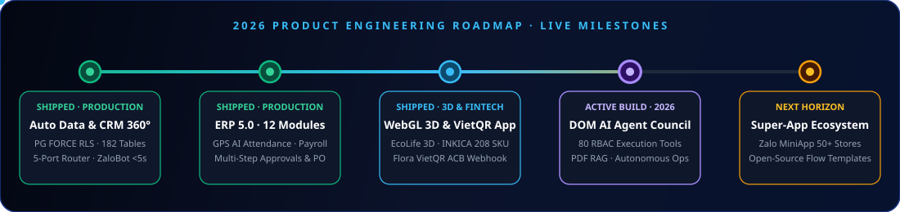

<!-- Animated Gradient Wave Header -->

 

<!-- Animated Typing Tagline (Software & Apps Only) -->

  

<!-- Custom Animated Cyber Grid, Radar & Energy Waveform Hero -->

  

<!-- Minimal Single-Row Action Bar -->

  

<!-- Animated Border-Laser & Equalizer Telemetry Cards -->

 

---

## ⚡ `PRODUCTION SOFTWARE MESH · MULTI-APP ARCHITECTURE`

 

 

---

## 📱 `LIVE PRODUCTION APPS & SOFTWARE SYSTEMS`

*Tất cả sản phẩm phần mềm, nền tảng SaaS, WebGL 3D & hệ thống AI đã thiết kế, lập trình và vận hành thực tế.*

 

<table>
  <tr>
    <td width="50%" valign="top">
      
       
      <h4>⚡ DOMATION Auto Data V2 — Multi-Tenant SaaS Kernel</h4>
      <b>Production Workspace</b> · TypeScript · Express · PostgreSQL / PGlite FORCE RLS
      <ul>
        <li>Kiến trúc <b>182+ bảng</b> cô lập dữ liệu tenant tuyệt đối bằng <b>Kernel FORCE RLS</b></li>
        <li>Động cơ phân bổ <b>5-Port Fair-Share Round-Robin</b>, cảnh báo ZaloBot <code>&lt; 5s</code></li>
        <li>Cơ chế SLA Auto-Recall, AI Pre-screener, bù ticket 1:1 &amp; Webhook 2 chiều</li>
      </ul>
      
      
      
    </td>
    <td width="50%" valign="top">
      
       
      <h4>🏢 DOMATION Enterprise ERP 5.0 — 12 Phân Hệ Vận Hành</h4>
      <b>Full-Suite ERP</b> · Task Kanban · HRM · GPS Attendance · Payroll · DOM AI
      <ul>
        <li>Quản lý dự án Task Kanban, Pomodoro Workspace, Gantt &amp; Hộp thư phê duyệt N bước</li>
        <li>Chấm công định vị <b>GPS Radius + AI Selfie</b> &amp; bảng tính lương <b>Payroll PDF</b> tự động</li>
        <li>Trợ lý điều hành <b>DOM AI Copilot (80 RBAC Tools)</b>, WorkChat &amp; Kế toán TT200</li>
      </ul>
      
      
      
    </td>
  </tr>
  <tr>
    <td width="50%" valign="top">
      
       
      <h4>📊 DOMATION CRM 360° &amp; Sales Pipeline Engine</h4>
      <b>B2B &amp; B2C CRM Suite</b> · Kanban 8 Stage · Live Inventory · Quotes &amp; Deposits
      <ul>
        <li>Hồ sơ khách hàng <b>360° Timeline</b> đa tab, gán Deals B2B &amp; lịch sử tương tác</li>
        <li>Quản lý rổ hàng live, báo giá SKU, đặt cọc đa đợt &amp; phiếu hợp tác chia hoa hồng</li>
        <li>Đồng bộ hóa đơn điện tử, lọc trùng SĐT đa chiến dịch &amp; che PII theo cấp RBAC</li>
      </ul>
      
      
      
    </td>
    <td width="50%" valign="top">
      
       
      <h4>🤖 Automation Flow Studio &amp; RAG AI Agents</h4>
      <b>Visual Builder Suite</b> · IF/ELSE Condition Tree · Email Drag &amp; Drop · Zalo ZNS
      <ul>
        <li>Trình dựng kịch bản kéo-thả rẽ nhánh <b>IF/ELSE</b> theo hành vi thời gian thực</li>
        <li>Email Editor 15 block kết nối <b>Amazon SES</b>, Survey/Quiz Builder &amp; QR Voucher Hub</li>
        <li>Huấn luyện <b>AI Chatbot đa kênh</b> từ tài liệu PDF nội bộ (Website, Zalo, Messenger)</li>
      </ul>
      
      
      
    </td>
  </tr>
  <tr>
    <td width="50%" valign="top">
      
       
      <h4>🏙️ EcoLife Signature · WebGL 3D &amp; AI Sales Portal</h4>
      <b>Capital House PropTech</b> · Three.js Draco 3D · AI Sales Assistant 24/7
      <ul>
        <li>Sa bàn tương tác <b>Three.js WebGL 8 căn hộ bóc mái 3D</b> nén Draco (<code>&lt; 3.5MB/model</code>)</li>
        <li>Trợ lý AI Sales Portal trực dự án 24/7 cho chuyên viên &amp; khách xem trực tuyến</li>
        <li>Tích hợp Auto Data Router 3 cổng đại lý F1 &amp; hệ thống QR Tracking 25 điểm OOH</li>
      </ul>
      
      
    </td>
    <td width="50%" valign="top">
      
       
      <h4>🎨 INKICA AI POD Studio · Multi-Agent 3D CAD Prepress</h4>
      <b>INKICA Global Studio</b> · Next.js 14 · Three.js · BullMQ GPU · SAM 3 + ViTMatte
      <ul>
        <li><b>Omni Orchestrator 6 AI Prepress Agents</b> chạy trọn quy trình trong <b>60 giây</b></li>
        <li><b>Neural Extract 300 DPI</b> tách nền &amp; chuẩn hóa tọa độ lưới UV Cubic Bezier</li>
        <li>Render <b>AOP 3D CAD 208 SKU</b> &amp; 88 Canonical Models với <b>0 px</b> lệch đường may</li>
      </ul>
      
      
    </td>
  </tr>
  <tr>
    <td width="50%" valign="top">
      
       
      <h4>💎 Nha Khoa Flora · Affiliate Portal &amp; VietQR ACB App</h4>
      <b>HealthTech Fintech</b> · VietQR Dynamic Generator · ACB Bank Webhook · HIPAA Mask
      <ul>
        <li>Cổng đặt E-Voucher tự động sinh mã <b>VietQR ACB</b> gán mã KOL/Đơn chính xác</li>
        <li><b>ACB Webhook đối soát real-time 100%</b>, duyệt rút tiền Napas 24/7 &amp; báo Zalo OA</li>
        <li>Partner Portal không cần mật khẩu qua Secret Hash Token, che SĐT chuẩn y khoa HIPAA</li>
      </ul>
      
      
    </td>
    <td width="50%" valign="top">
      
       
      <h4>🌐 DOMATION.NET Portal · Rich Land &amp; Nava E-Commerce</h4>
      <b>Fullstack Web &amp; Commerce</b> · React 19 · Vite SSR Prerender · Knowledge RAG · SEO/GEO
      <ul>
        <li><b>DOMATION.NET</b>: Cổng sản phẩm + Blog kiến trúc (<code>/boost</code>) + 89 HTML Prerender &amp; <code>llms.txt</code></li>
        <li><b>Rich Land PropTech</b>: App CRM Tranh nhận (Pool Claim) / Chia vòng &amp; kho DataBank</li>
        <li><b>Nava Store &amp; Brandson</b>: Web E-Commerce <code>&lt; 3s</code> tải trang, đồng bộ giỏ hàng &amp; hóa đơn ĐT</li>
      </ul>
      
      
      
    </td>
  </tr>
</table>

 

<b>🧩 Xem thêm Hệ thống Web/App, Công cụ &amp; Repo Open-Source trong 69+ Repositories</b>

 

| App / Repo | Category | Highlights & Stack | Link |
|:---|:---|:---|:---|
| **DOMATION_TENANRT** | SaaS Backend Kernel | Multi-Tenant PostgreSQL / PGlite FORCE RLS, 182+ tables, RBAC 4 tiers, VietQR, OCR | [GitHub](https://github.com/DEV-trongphuc/DOMATION_TENANRT) |
| **domation_page** | SaaS Portal & Blog | DOMATION.NET React 19 + TypeScript + Vite SSR Prerender + 50+ Technical Articles | [GitHub](https://github.com/DEV-trongphuc/domation_page) |
| **portfo** | Interactive Portfolio | Executive 3D Portfolio Showcase (`portfo-turnio.vercel.app`) with AI RAG Search | [Live](https://portfo-turnio.vercel.app/) · [GitHub](https://github.com/DEV-trongphuc/portfo) |
| **EDU-APP & IDEAS_ERP** | EdTech & ERP 5.0 | Academic Gradebook, Timetable, HRM Attendance GPS, Payroll PDF & Admissions CRM | [GitHub](https://github.com/DEV-trongphuc/EDU-APP) |
| **ImplantSwiss Việt Nam** | B2B Medical CRM | Regional Row-Level Security isolation & Phone Masking Audit portal | [Live](https://implantswiss.vn/) |
| **NAVATEK & MINTH Store** | Brand & Commerce Web | Custom high-speed storefronts & interactive Web product showcases | [NAVATEK](https://github.com/DEV-trongphuc/NAVATEK) · [minth](https://github.com/DEV-trongphuc/minth) |
| **dom_tools / divideo / video_ui** | Internal Dev Tools | Video & media workflow UI tools, YouTube transcript extractor & data utilities | [dom_tools](https://github.com/DEV-trongphuc/dom_tools) · [divideo](https://github.com/DEV-trongphuc/divideo) |
| **Tarot-Vibecode & vnstock** | Side Projects | Interactive Mystical Web App (`mystery-tarot.net`) & Vietnam stock analysis tools | [Tarot](https://github.com/DEV-trongphuc/Tarot-Vibecode) · [vnstock](https://github.com/DEV-trongphuc/vnstock) |
| **slider · sliderInfinity · library** | Open-Source UI | Popular frontend animation sliders & utility libraries (**29+ GitHub Stars** combined) | [slider ⭐10](https://github.com/DEV-trongphuc/slider) · [sliderInfinity ⭐7](https://github.com/DEV-trongphuc/sliderInfinity) |

 

---

## 🪐 `ANIMATED TECH ORBIT & ENGINEERING STACK`

 

  

 

---

## 📊 `LIVE GITHUB TELEMETRY (@DEV-trongphuc)`

 

  

&nbsp;

  

  

 

---

## 🚀 `2026 PRODUCT ROADMAP (ANIMATED TIMELINE)`

 

 

---

## 🤝 `30+ CLIENT SYSTEMS & ENTERPRISE PARTNERS`

<table>
  <tr>
    <th>🏗️ Real Estate &amp; AI Tech</th>
    <th>🎓 Education &amp; EdTech</th>
    <th>🍽️ F&amp;B &amp; Franchise Apps</th>
    <th>🏥 Dental, FinTech &amp; Retail</th>
  </tr>
  <tr>
    <td>
      • <b>Capital House Group</b> 
      • <b>EcoLife Signature Đà Nẵng</b> 
      • <b>INKICA AI POD Studio</b> 
      • <b>Rich Land PropTech</b> 
      • Địa Ốc Tùng Long · Hợp Nhất Land · IHD
    </td>
    <td>
      • <b>IDEAS Business Institute</b> 
      • <b>Swiss UMEF</b> · <b>Collège de Paris</b> 
      • <b>ESTIAM Paris</b> · <b>ISTEC Paris</b> 
      • Ascencia Business School · VTCI Edu
    </td>
    <td>
      • <b>Phúc Lộc Thọ</b> (30+ POS Sync) 
      • <b>Ampersand Group</b> · <b>En Group</b> 
      • <b>Häagen-Dazs</b> · <b>The Running Bean</b> 
      • Esta Saigon · Snowee · Kiwami · KA-EN
    </td>
    <td>
      • <b>Nha Khoa Flora</b> (VietQR ACB) 
      • <b>ImplantSwiss</b> · <b>Brandson Academy</b> 
      • <b>Navastore</b> · <b>Navatek</b> · <b>MINTH Store</b> 
      • Duyên Mai · Mystery Tarot · Tiên Hoàng
    </td>
  </tr>
</table>

<b>🏅 Verified Certifications (freeCodeCamp · Fullstack F8 · TOP CV)</b>

 

| Certificate | Issuer | Year | Verify |
|:---|:---:|:---:|:---:|
| Front End Development Libraries | freeCodeCamp | 2021 | [Verify](https://www.freecodecamp.org/certification/trongphuc3105/front-end-development-libraries) |
| Responsive Web Design | freeCodeCamp | 2021 | [Verify](https://www.freecodecamp.org/certification/trongphuc3105/responsive-web-design) |
| JavaScript Advanced | Fullstack F8 | 2022 | [Verify](https://f8.edu.vn/certificates/t7s3s) |
| ReactJS | Fullstack F8 | 2022 | [Verify](https://f8.edu.vn/certificates/7jzkn) |
| HTML / CSS | Fullstack F8 | 2021 | [Verify](https://f8.edu.vn/certificates/t7s3s) |
| JavaScript — Top 20% | TOP CV | 2023 | [Verify](https://certificate.testcenter.vn/dUR8Uz0fMlcZNV9GVjE2bFN7SXU) |

 

---

> *"Kiến tạo phần mềm doanh nghiệp may đo tốc độ cao — từ SaaS Kernel bảo mật RLS, ERP 5.0 đến WebGL 3D &amp; Multi-Agent AI."*  
> — **Huỳnh Trọng Phúc (`@DEV-trongphuc` · `TURNIO`)** · [domation.net](https://domation.net) · [LinkedIn](https://www.linkedin.com/in/turnio-dev/) · [TikTok @turnio.dev](https://www.tiktok.com/@turnio.dev) · [Facebook](https://www.facebook.com/3105trongphuc)

 

